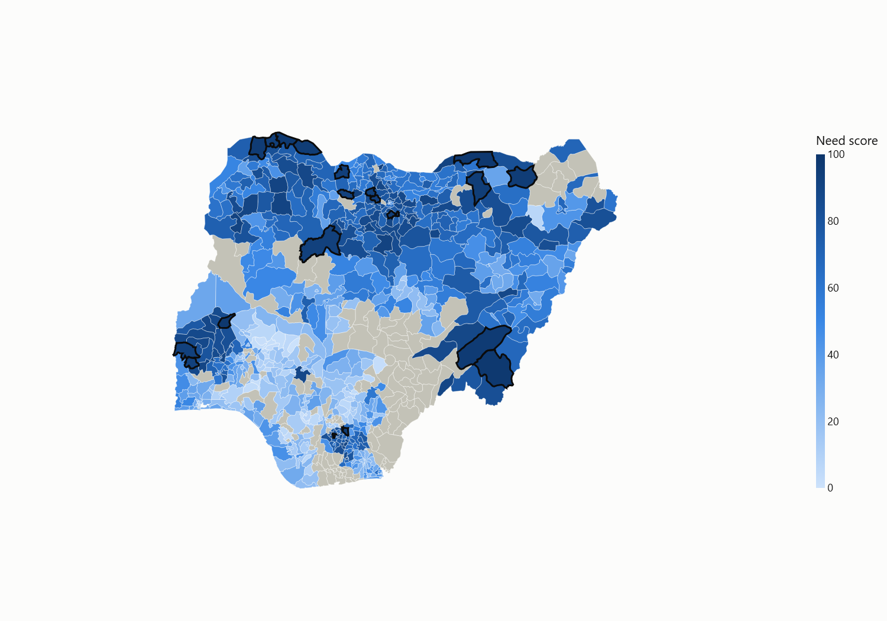
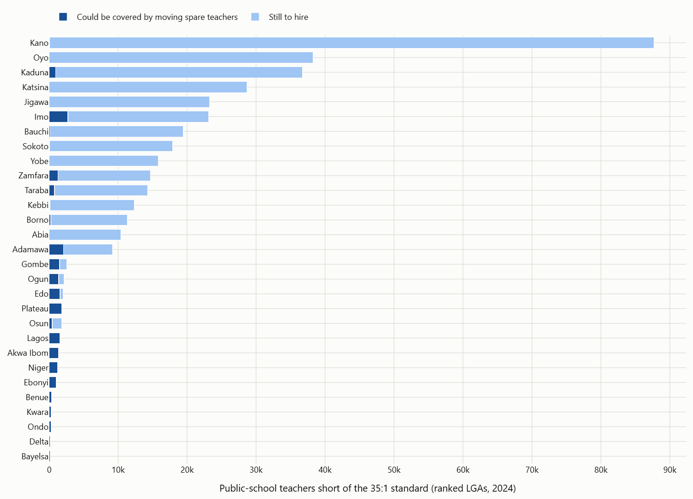
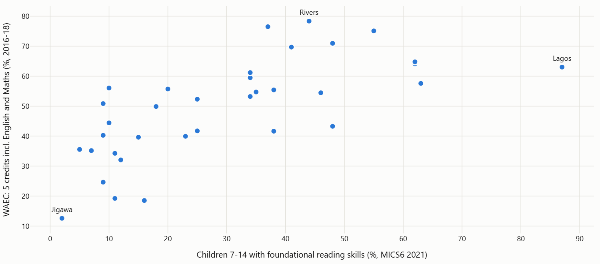

# Where Should the Next Teacher Go?

**YDP Community Datathon 2026, Education track.** A decision tool for state and federal basic-education planners. It ranks Nigeria's 774 Local Government Areas (LGAs) by how far their public schools fall short of the government's own Universal Basic Education (UBE) standard of **35 learners per teacher and per classroom**, sizes the gap in teachers and classrooms, and says plainly how much each ranking can be trusted.



## The problem

Nigeria publishes a lot of education data, but it is spread across the Federal Ministry, UBEC, NBS and WAEC and is rarely turned into an answer to the question a planner actually faces: **where should the next batch of teachers and classrooms go?** Two things make this harder than it looks:

1. **Uneven reporting.** In the 2024 Annual School Census, 101 of 774 LGAs returned fewer than half of their expected school forms, and Rivers, Cross River and Nasarawa are almost blank. A ranking that ignores this rewards LGAs for not reporting.
2. **Mismatched levels.** Exam results (WAEC) are published by state, while teachers are posted by LGA. Tools that blur the two mislead.

**Intended user:** a State Universal Basic Education Board (SUBEB) or federal planner deciding teacher deployment and classroom construction.

## What it shows

- **The 20 LGAs most in need**, nationally or within any state, with learners per teacher and per classroom, **teachers and classrooms needed** to reach 35:1, the main driver, and a **confidence grade** (A/B/C). Downloadable as CSV.
- In the current national top 20: **33,768 teachers** and **35,062 classrooms** short, serving **1.49 million** public-school learners (2024).
- **"Not ranked" is a finding.** 132 LGAs are listed with the reason (too few census returns, or implausible counts) instead of being estimated.
- **Long-running shortages:** LGAs also in the worst quarter in the independent 2014 NMIS school survey.
- **State outcome context:** WAEC results (2016-2018) next to MICS6 2021 foundational reading and numeracy.
- **Move or hire?** Whether moving spare teachers within a state could close the gap, and what is left to hire.
- **Budget planner:** enter your own cost per teacher, cost per classroom and budget; LGAs are funded in priority order.
- **Beyond the ratio:** women teachers, junior secondary seats, private-school alternative and change since 2014, each with a threshold you set.

## Beyond the ranking: what else the census shows

All from the same 2024 census (ranked LGAs, public schools) unless stated. They describe where gaps occur together, not why.

| Question | Finding |
|---|---|
| Can moving teachers close the gap? | **Mostly no.** Even if every teacher above the 35:1 standard moved to the neediest LGA in the same state, it would cover **6%** of the 380,212-teacher shortfall (21,487). Spare teachers sit mostly in Kwara, Enugu and Ekiti. Moves could close the gap in 9 states; the 20 states where they fall short hold 98% of the shortfall, so there hiring is the main route. |
| Where are women teachers scarce? | In 95 LGAs, under 20% of public teachers are women (median LGA: 52%), including 8 of the national top 20. Higher-need LGAs tend to have fewer (Spearman -0.49, 642 LGAs). |
| Is there a junior secondary seat after primary? | The median LGA has 0.39 public JSS learners per primary cohort. Higher primary need goes with fewer JSS learners per cohort (Spearman -0.61, 414 LGAs with at least 75% JSS returns). |
| Is there a private alternative? | Only 34% of expected private-school forms were returned nationally. Where at least half came back (284 LGAs), private schools hold under 5% of learners in 89. Higher-need LGAs tend to have smaller private shares (Spearman -0.57). |
| Better or worse than 2014? | Of 637 LGAs measured in both the 2014 NMIS survey and the 2024 census, 395 have over 20% more learners per teacher, 134 are similar and 108 improved. All of today's national top 20 are worse. |



Values no dataset holds (share of spare teachers who can move, JSS target, thresholds, unit costs, budget) are inputs in the app. Defaults are in `config/settings.yaml`; costs have no default.

## How we know it holds up

| Check | Result |
|---|---|
| 1,000 random alternative weightings | 15 of the top 20 stay in the top 20 at least 80% of the time |
| Agreement with a purely statistical summary (PC1) | Spearman 0.99 |
| States with higher need vs MICS6 2021 (never an input) | more out of school (+0.46), lower reading (-0.49), lower numeracy (-0.59); 35 states, all p < 0.01 |
| 2024 census vs UBEC 2018 (state) and NMIS 2014 (LGA) | +0.61 and +0.57 |
| Do reported resources predict WAEC results? | **No** better than the national average out of sample. So no state is labelled an over- or under-performer, and LGAs are ranked on measured gaps, not predicted results |



## Run it

Requires Python 3.12.

```bash
python -m venv .venv
.venv/Scripts/python -m pip install -r requirements.txt     # macOS/Linux: .venv/bin/python
.venv/Scripts/python -m streamlit run streamlit_app.py
```

The repo ships the processed tables, so the app starts in seconds with no downloads. Add `?demo=1` to the URL for the fixed demo path.

To rebuild everything from raw public data (downloads about 90 MB, extracts and reconciles every table, rebuilds both lenses, runs the tests and re-renders the figures):

```bash
.venv/Scripts/python scripts/reproduce.py
```

### Dash version

`dash_app.py` is a second front end with the same data and calculations (`pipeline/insights.py`, `figures.py`): Mantine components, AG Grid tables, an on-page light/dark switch that remembers the viewer's choice, and linked views (click an LGA on the map or in the table to open it).

```bash
.venv/Scripts/python dash_app.py          # http://localhost:8050, add ?demo=1 for the demo path
```

To deploy, `python scripts/build_deploy.py` writes `build/deploy` with only what the app needs: `app.py` and `requirements.txt` for Plotly Cloud (free tier: one public app; drag the folder's contents into the browser), and a `Dockerfile` for Render or any Docker host (runs `gunicorn dash_app:server`).

**Using fresher data from a partner:** set `lga_input.adapter: csv` in `config/settings.yaml`, map the partner's column names, and rebuild. No code changes.

## Data sources

| Source | Publisher | Unit | Vintage | Status | Use | Licence |
|---|---|---|---|---|---|---|
| Annual School Census (DNEMIS) | Federal Ministry of Education | LGA | 2024 | Real, public | Ranking | Public government portal; no explicit licence stated |
| Subnational administrative boundaries (COD-AB) | OCHA via HDX | LGA | 2019-2025 | Real, public | Map, name matching | CC BY-IGO |
| Subnational population statistics (COD-PS) | UNFPA via HDX | LGA | 2020 projection | Real, public, projected | Plausibility checks, hidden-demand flag | CC BY-IGO |
| NMIS education facility data | OSSAP-MDGs and Columbia SEL ([official release](https://energydata.info/dataset/nigeria-nmis-education-facility-data-2014)); bytes from a [Kaggle mirror](https://www.kaggle.com/datasets/ayeniibukun/educational-facilities-in-nigeria) | School | 2009-2014 | Real, public | Long-running shortage, 2014 facility conditions | CC BY 4.0 |
| WAEC Results Statistics 2016-2018 | NBS | State | 2016-2018 | Real, public | State context | NBS public release |
| Digest of Basic Education Statistics 2019 and 2020 | UBEC | State | 2018-2020 | Real, public | Resource test, cross-check | UBEC public release |
| Education Fact Sheets (MICS6 2021) | UNICEF / NBS | State | 2021 | Real, public | Validation only | UNICEF publication |
| MICS6 2021 state tables workbook | Community transcription on [Kaggle](https://www.kaggle.com/datasets/tinaukabi/nigeria-education-access-and-outcomes-by-state-2021) | State | 2021 | Real, public | Cross-check only | Not stated |
| GRID3 education facilities | GRID3 via HDX | School | ~2020 | Real, public | Audited, not used (Niger State missing, teacher fields 7.5% filled) | CC BY |

**No synthetic data is used.** A synthetic Kaggle "2024 JAMB" dataset was reviewed and rejected. Full audit: [`docs/DATA_AUDIT.md`](docs/DATA_AUDIT.md). Download provenance with SHA-256 hashes: `data/raw/provenance.csv`. Reconciliation reports for every extracted table: `reports/`.

## Limitations

- Counts are as reported by schools. The confidence grade shows where reporting is thin but cannot catch every error.
- The ranking covers public schools only. Private schools enrol many children in some LGAs, especially in cities; private returns are too thin (34%) to add them to the ranking.
- LGA population figures are projections from the 2006 census and are used only for checks and a flag.
- WAEC results exist only by state and only for 2016-2018 here; Taraba 2018 is excluded because the published figure is a misprint (75 candidates vs 21,754 the year before).
- This is a prioritisation aid. It shows where gaps are largest, not why.

## Repository map

```
streamlit_app.py      the app (decision, move or hire, budget, beyond the ratio, state context, method)
dash_app.py, dashapp/ the same app in Dash (layout, callbacks, shared data)
figures.py            chart builders shared by the app and scripts/render_figures.py
pipeline/             extraction, crosswalk, Lens 1 index, insights, Lens 2 test, validation, build
config/               settings.yaml (weights, thresholds, partner column map), alias and reason tables
data/processed/       tables the app loads (committed)
reports/              reconciliation and unmatched-record reports
tests/                pytest: reconciliation, crosswalk, index logic, insights
docs/                 data audit, write-up, figures
BUILD_LOG.md          dated record of every decision and dead end
```
